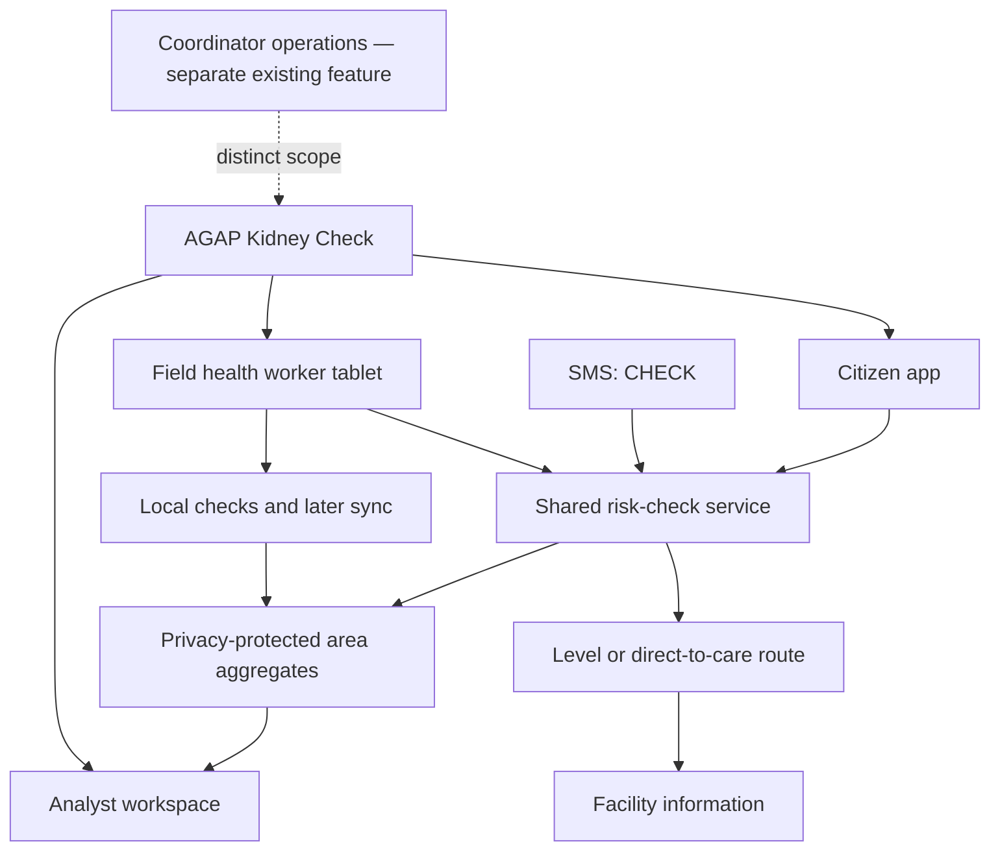

# AGAP-CKD PRD v3 — information architecture

**Basis:** [PRD v3](../../AGAP-CKD-PRD-v3.md), [screen content plan](../../AGAP-CKD-Screen-Content-Plan.md), and [ADRs](../../ADR/), all as present on `initial-frontend-setup` at `66813c7`.
**Purpose:** a portable, target-state map of the product's information, routes, decisions, and cross-channel rules. This is a PRD interpretation, not a record of what the current frontend already does. The companion [coverage audit](requirements-coverage.md) maps that target to implementation.

## Product structure

The PRD names **three role views**: Citizen, Field health worker, and Analyst. SMS is a fourth **delivery channel** for the citizen check, with no visual app navigation. The current Coordinator worklist is a separate operations capability from the earlier prototype; PRD v3 does not define it as one of the three views. Do not place its individual-level case data inside the analyst view.

The shared service holds question definitions, allowed answers, scoring, validation cut-offs, guideline floor, next-step rules, and display-safe result content. The app, tablet, and SMS render the same underlying check for their device or medium. Analyst data is aggregate output only.

## Citizen app sitemap and flow

| ID | Screen / node | Primary job | Exit |
|---|---|---|---|
| C1 | Three onboarding cards | Explain kidney function, silent early problems, and blood-and-urine testing | Next / Skip → C2 |
| C2 | Invitation | Ask whether the resident wants a risk check | Start → C3; Not now → education/home |
| C3 | Consent and privacy | Explain data, purpose, visibility, retention | Agree → C4; Not now → C8 |
| C4 | Safety pre-check | Route under-18, pregnant, or acute-symptom residents out of scoring | Yes → C4a; No / Don't know → C5 |
| C4a | See a doctor | Give direct-care guidance without a risk level | Facilities → C7; Home |
| C5 | Questionnaire | Capture one item per step, with progress and Why we ask | Complete → C6; Back |
| C6 | Result and action | Explain Low/Medium/High level, next step/date, reasons, tips | Facilities → C7; Done / Share text / Start over |
| C7 | Where to get checked | Show facilities and verification status for selected town | Change town; return to result |
| C8 | Education only | Give information after declined consent; collect no health answers | Start check → C3 |
| C9 | Already told something is wrong | Route to ongoing clinical care without risk level | Facilities → C7 |

The PRD's main sequence is `C1 → C2 → C3 → C4 → C5 → C6 → C7`. C4a, C8, and C9 are explicit off-path destinations. The PRD asks kidney status last, which means C9 may occur after the questionnaire; its open questions consider moving that check earlier in the app. This IA preserves the documented order and records that decision below.

### C5 question taxonomy

| Group | Order / fields | Branching and display rule |
|---|---|---|
| Safety | 0: combined pre-check | First; direct-to-care on Yes |
| Personal context | 1 age group; 2 sex; 3 municipality | Municipality chooses facilities and heat context, not personal score |
| Major risk history | 4 diabetes; 5 high BP | Yes/No/Don't know; explicit Yes participates in guideline floor |
| Conditional history | 6 BP/sugar medicine; 7 BP reading | Medicine only when diabetes or high BP = Yes; BP reading only when high BP = No/Don't know |
| Other health history | 8 heart disease/stroke; 9 kidney stones; 10 family history | Each supports Don't know |
| Body / work | 11 height and weight; 12 heavy outdoor work | Unit conversion and unknown state; outdoor work may trigger advisory |
| Care status | 13 kidney status | “Told something was wrong” → C9, no risk level |

Question progress recomputes when conditional items are skipped. “I don't know” is consistently the last option. The questionnaire asks one item per screen, except the combined pre-check and height/weight input. Sex, height, stones, heart disease/stroke, and family history may be prefilled on a later app visit with a “Still correct?” check.

### Result content hierarchy and decisions

C6 contains, in order: (1) risk level in words; (2) exact not-a-diagnosis statement; (3) next step and month/year; (4) 2–3 illustrative reasons; (5) conditional heat advisory; (6) 2–4 answer-based tips; (7) worried-reader note for Medium/High; (8) facilities or link; (9) answer-again-sooner guidance; (10) disabled partner-booking placeholder. The map/location feature is C7 information, not a substitute for a test-capability statement.

| State | First action | Follow-up destination |
|---|---|---|
| Safety route or known kidney problem | Seek a clinician; show facility information | C4a or C9; no Low/Medium/High level |
| Low, age 18–39, no factors, recent normal BP | Re-check in 3 years | C6; no kidney-test prompt |
| Low, age 40+ or any factor | Re-check in 12 months | C6 |
| Medium, no diabetes/high BP | Get BP and sugar checked, then re-check | C6; day-30 reminder if opted in |
| Medium/High, diabetes or high BP | Blood and urine kidney test; yearly thereafter | C6 → C7; day-7 and day-30 reminders if opted in |

A separate blood-sugar prompt applies at age ≥40 or BMI ≥23 when diabetes is No/Don't know. The guideline floor can raise levels after the model; “Don't know” enters the model as Yes but does not itself trigger the floor under the current ADR. Heat is not a municipality-level personal risk factor.

## Field tablet IA

| ID | Screen / node | Core content | Exit |
|---|---|---|---|
| F1 | Today | Check number, time, barangay, level; due re-check count; waiting-to-sync count | Start new → F2; Sync when online |
| F2 | Read-aloud consent | Script, language toggle, resident-agreed checkbox | Agree → F2b; Decline → C8-style education |
| F2b | Risk check | Same C4 and C5 content with larger controls | Direct care or F3 |
| F3 | Result and referral note | Level, disclaimer; Medium/High note with reason, facility and next date; Low re-check date | Done saves locally → F1; read note aloud |

Field checks are anonymous within the PRD: no names or resident ID numbers in Today. Local storage keeps pending checks through reload and loss of connectivity. Sync sends them later; retries/conflict handling and at-rest encryption are Phase 2. A family member's reminder number is optional and requires that person's consent.

## SMS IA

SMS begins when a resident texts **CHECK**. It has no navigation page; its architecture is a conversation state machine using the same check contract.

`S1 consent → S2 safety → S3 question loop → S4 result (2–3 messages) → optional reminders → S5 reminders`.

Branches: S2 Yes → S2a direct-care message; unclear answer → S3-err once; timeout → S6 and TULOY resume; lower repeat level within 30 days after an earlier Medium/High → S6-e holds earlier advice. STOP, HELP, and BACK work throughout. Result includes level, disclaimer, reason, next step/date, and one facility. The messages use numbered answers, ≤160 GSM-7 characters, and 7 AM–9 PM sending hours. A reminder phone number is kept apart from answers and deleted under the PRD retention rules. This is a Phase 1 specification even though live carrier integration remains a Phase 2 roadmap item; the distinction needs a team decision.

## Analyst IA

| ID | Surface | Information order and navigation |
|---|---|---|
| A1 | Province map, default | Municipality-level age-standardised Medium/High share among people checked; check-count suppression, legend, province totals; metric switch for share / coverage / awareness gap; town selection → A2 |
| A2 | Municipality detail, side panel | Share and confidence range, number of checks; coverage; awareness gap and text-only suggested drive; app/field/SMS split and last sync; modifiable factors if ≥30 checks; self-reported DONE replies |
| A3 | Climate context, separate tab | Heat and rainfall over time for selected municipality; explicit context-only label |
| A4 | Model quality, collapsed judge detail | AGAP vs Thai benchmark on same cohort, catch rate, abnormal rate by level, AUC, cut-off rule, floor effect, prevalence sensitivity, run ID, outcome definition and source |

Every analyst screen carries the simulated-data / among-people-checked context. No individual-level records or age/sex cross-tabs appear here. Suppression applies below 10 checks; 10–49 are faded; factors are hidden below 30. Coverage denominator is PSA adult population. The map counts checks, not unique people.

## Shared information objects

| Object | Used by | Minimum fields / contract |
|---|---|---|
| Check answers | Citizen, field, SMS, scoring | Question ID, coded answer, channel, municipality, completion state; names excluded |
| Risk result | Citizen, field, SMS | Level or direct-care route; floor applied; illustrative reasons; next step and date; disclaimer; facility suggestions; no raw probability shown to citizens |
| Facility | C4a/C6/C7/F3/S4 | Actual name/type, municipality, location, test capability Yes/No/Unknown, verification status and call-ahead wording |
| Field pending check | Tablet and sync | Anonymous check number, time, barangay, level, sync status and receipt; durable on device |
| Analyst aggregate | A1/A2 | Town, period, check count, age-standardised share/range, coverage, awareness gap, channel split, factor summary, suppression flags |
| Model-quality evidence | A4 | Frozen run ID, validation cut-offs, held-out AGAP/Thai measures, floor effect, prevalence sensitivity, provenance |
| Reminder consent | SMS, optional field | Phone number separate from answers, last level, opt-in, send/delete dates |

## Navigation and scope boundaries

- **Role separation:** citizen and field see individual guidance; analyst sees only protected aggregates. Coordinator case management is an existing parallel workflow and requires its own operations IA if retained.
- **Content consistency:** the same result disclaimer, exact level meaning, facility caveats, and next-date semantics appear in app, tablet, and SMS.
- **Terms:** use “risk check” for the questionnaire; reserve “blood and urine test” for clinical testing. A re-check is answering the questionnaire again.
- **Privacy:** consent precedes health questions; decline routes to education. Analyst displays suppression and “among people checked” context.
- **Future roadmap:** partner booking, diagnosed-patient education, check-ins, health-app imports, Messenger, SMS carrier integration, offline conflict handling and encryption remain outside the Phase 1 flows unless the team changes scope.

## Decisions to resolve before implementation

1. Should kidney status move before the other questions in the app? The PRD places it last, then flags that delay as an open question.
2. Should the coordinator remain a fourth top-level tab, or live behind a separate operations entry? PRD v3 defines only three role views.
3. Does Phase 1 include a working SMS transport or only the message/state-machine prototype? The PRD requires a complete SMS flow but defers carrier short-code confirmation.
4. Which facility dataset has verified names, town assignments, and test capabilities? Demo capability must remain Unknown until checked.
5. Is the web app confirmed as the offline-capable common platform? ADR 0003 is still marked proposed.
