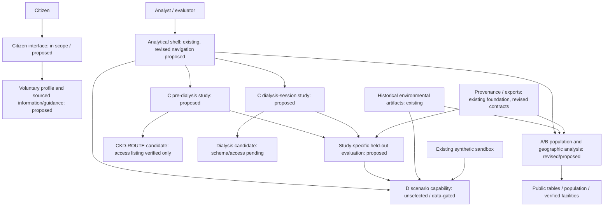
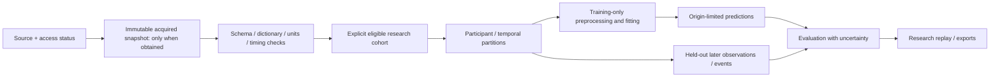

# AGAP-CKD — Proposed System Architecture

## Version 3 — Separate population and longitudinal analytical flows

**Status: PROPOSED. No implementation or clinical validation is implied.**

Updated 23 October 2026 (Asia/Manila), `bry-research` at `ecab5466a970bbee63c50508e0a56f35b6d99ed5`, including this working-tree documentation revision. The [Version 3 PRD](PRD.md) defines V3-001–014, source access and scope. The [current architecture](../../ssot/ARCHITECTURE.md) remains the historical implemented baseline at its own recorded commit. Dataset candidates are not acquired or file-verified by this revision.

## 1. System boundary

Reuse the Python/Streamlit analytical shell, geographic processing and reproducibility mechanisms. Introduce separate research adapters for empirical datasets. The citizen-facing experience remains in product scope; only detailed UX discussion is paused. Citizen profile/content/output components are proposed, not implemented. Real provider workflows and institutional integration remain unconfirmed dependencies. Product branches represent analytical populations, not enforced application roles or clinical transition rules.

No arrow implies that foreign cohort participants are residents of mapped Philippine locations. Environmental context is not a clinical predictor without an appropriate linked study.

### Proposed capability gates after local inspection

The shell should expose supported analysis and dependency status rather than promise that all branches work. See [PRD feasibility-to-scope mapping](PRD.md#data-feasibility-now-controls-release-scope), V3-013/014. These controls are proposed, not existing behavior.

| Capability | Proposed availability contract |
|---|---|
| National indicator explorer | Requires structured source-checked estimates/intervals with page, definition, population and period; PDF alone is source material, not a finished adapter. |
| Geographic reference | Local boundary artifact/version available; map must not imply a public population frame. |
| Population weighting | Requires acquired compatible counts and verified geographic/age crosswalk. Current saved run is fixture; reject it as a public frame. |
| Service coverage | Requires verified coordinates and explicit service definition/completeness. Queue currently has 0/111 coordinates. |
| Empirical studies/augmentation | Requires acquired dataset/dictionary and validated target/split contracts; source listing alone is insufficient. |
| Heat index | Requires compatible humidity/dew-point/temperature and documented processing; temperature/rainfall alone fails the contract. |
| D scenario | Requires selected question, output, constraints and source/assumption provenance; not enabled simply because generator code exists. |

**Proposed source/capability state:** listed → acquired → schema-checked → analysis-ready, with unavailable/blocked reason and the snapshot used for each state. A capability is ready only when its own required contracts are satisfied. Report stale/mismatched sources explicitly. New status storage/manifest fields need implementation; current run manifests alone do not establish them.

An unavailable public capability must never silently load a fixture or synthetic substitute under the same label. Fictional profile records remain isolated from observations and public denominators. Add source-contract/availability components alongside, not inside, the clinical model code; exact paths remain implementation choices.

## 2. Component map

| Component | Status | Responsibility / requirements |
|---|---|---|
| `app/main.py`, `src/agap/walkthrough.py` | Existing; proposed revised navigation | Professional analysis plus a proposed citizen entry for the two citizen states; detailed citizen UX/channel remains open. V3-001/011. |
| `data/geography.py`, mapping/basemap modules | Existing foundation; revised analyses proposed | Compatible population frame and geographic joins, plus explicit missing-location coverage. Roads currently display only. V3-002/003. |
| Citizen profile / information / guidance components | Proposed, in product scope | Use purpose-justified optional fields from DATA_SPEC; separate factual inputs from derived outputs. Fictional demonstration supported; real handling/deployment unspecified. No validated warning model implied. V3-011. |
| Published-table/survey adapter | Proposed | Source definitions, survey design, supported geography, population/time denominators. FNRI microdata unavailable; table fallback. V3-002/008/009. |
| Facility registry/verification modules (`clinics.py`, `clinic_ui.py`) | Existing foundation; revised analysis proposed | Preserve identity/location/capability distinctions; no inferred operational capacity. V3-003. |
| CKD-ROUTE adapter and progression study | Proposed | Workbook/schema discovery, repeated-measurement versus event-table distinction, cohort selection and censoring. V3-004/005. |
| Dialysis-session adapter and study | Proposed | Patient/session keys, timing, units, outcome definition and strictly prior inputs. V3-004/005. |
| `experiment.py`, `demo.py` scoring/allocation | Existing synthetic mechanisms | Reuse utilities selectively; existing fitted models remain synthetic. They are not pretrained clinical predictors for the new cohorts. V3-008. |
| Population scenario engine / separate augmentation experiment | Proposed; existing simulation utilities reusable | Constrain declared characteristics to public statistics; vary assumed dependencies and propagate uncertainty. First output remains undecided. No required patient timeline. Keep augmentation generator within training partitions. V3-006/008/010. |
| Climate modules | Existing; new heat-index transformation proposed only if inputs acquired | Historical temperature/rainfall context; humidity/dew-point acquisition needed for heat index. V3-007. |
| Manifests, `integrity.py::check_run`, exports | Existing foundation; revised contracts proposed | Data/study versions, actual score variant and evaluation provenance. Existing checks do not verify new empirical datasets automatically. V3-009/012. |
| `workflow.py`, `workflow_store.py` | Existing, optional fictional example | Preserve current records; no conversion into real patient/service records. V3-011. |

Paths are relative to `src/agap/` unless stated. Exact new filenames and dependencies are implementation choices, not files already created.

## 3. Data separation and source lineage

Maintain three namespaces: **public aggregate/geographic**, **observed research cohort**, and **synthetic**. A future real citizen/operational namespace is proposed but not implemented; define access, purpose, retention and source provenance before real collection. Synthetic citizen demos remain in the synthetic namespace. Never join people across datasets by demographic resemblance; never assign precise Philippine coordinates to foreign records.

| Layer | Input → transformation → output | Boundary |
|---|---|---|
| A population context | Secured survey tables/microdata → definition checks, weights and uncertainty as applicable → profiles at supported resolution | Region-level rates cannot generate observed municipal cases or individual joint distributions. |
| B geographic coverage | Population/boundary versions + verified coordinates/service definitions → geographic joins and clearly defined coverage calculation → descriptive coverage and missingness | No routing/travel-time claim from straight-line distance or visual roads. No unverified facility capability. |
| C pre-dialysis | CKD-ROUTE candidate → inspect workbook, time fields, outcome/censoring and repeated measures → study-specific baseline/longitudinal tables | Dataset listing is not schema verification. UPCR and UACR are distinct measurements; preserve original units and definitions. |
| C dialysis | Session candidate → verify keys/timestamps, measurement order and label construction → strictly past input windows and later targets | Complete-case selection and irregular monitoring affect representativeness. Post-session values cannot predict earlier events. |
| C cross-sectional | NHANES candidate modules → documented within-survey participant linkage and eligibility/weight handling → observed measurement study | Not progression follow-up or persistent CKD diagnosis. No participant linkage to Philippine maps. |
| D environmental | Existing ERA5-Land hourly temperature/precipitation → local-day/history processing → environmental context | Heat index additionally needs humidity or derivable humidity. Reanalysis is historical, not a live future forecast. |
| D synthetic | Configured generator/assumptions → scenario runs → conditional outputs | Synthetic truth stays outside empirical training/evaluation. Predictive associations are not causal intervention models. |

Active source scope follows the [approved inventory cleanup](../../evidence/2026-10-23-proposed-data-inventory.md#9-sources-removed-from-active-version-3-scope): no UCI benchmark, CRIC/HEMO/USRDS participant acquisition, unselected morbidity/mortality-series adapter, ENSO-advisory predictor or road-routing dependency. Existing basemap display and historical files remain. HEMOBP remains a separate candidate, not the excluded HEMO study.

Dataset/reference URLs and access qualifications are canonical in PRD §4. An external source listing and downloaded/inspected/analysis-ready states must remain distinct. Existing local source material is described in [data_sources.md](../../../docs/data_sources.md) and [parameter register](../../../config/parameter_register.yaml).

## 4. Proposed entities and identifiers

| Entity | Required contract |
|---|---|
| `SourceSnapshot` — proposed extension | Publisher/DOI/version, retrieval date, checksum, terms, access state and dictionary reference. Do not fabricate download dates. |
| `AggregateIndicator` — proposed | Definition, numerator/denominator, age/sex scope, geography code/version, period, estimate type and uncertainty. |
| `FacilityEvidence` — existing concept, revised | Source identity, independently supported coordinates and capability, verification date, missing/unknown flags. |
| `ResearchParticipant` — proposed | Source-scoped pseudonymous ID, cohort/eligibility flags; no real-citizen account linkage. |
| `Observation` — proposed | Participant/session key, measurement time, available-at time if known, analyte/value/unit and provenance. |
| `OutcomeFollowup` — proposed | Explicit endpoint, time origin, event time/indicator, censoring time/reason where recorded and competing outcomes. |
| `StudyRun` — revised manifest concept | Source/cohort/split identifiers, preprocessing, model/baseline, feature list, target/horizon, seed and evaluation outputs. |
| `ReplayStep` — proposed | Held-out case, cutoff, only available observations, prediction/interval and subsequently revealed target. |
| `ScenarioRun` — existing foundation, revised | Model version, initial conditions, user assumptions, horizon and output meaning; distinguish forecast versus hypothetical simulation. |

Relations: source → participant → observations; participant → sessions → within-session observations; participant → event/censoring record. Geographic aggregate indicators join by compatible area codes, never by research-person ID. Confirm released identifiers before promising patient-disjoint evaluation.

## 5. Algorithms and evaluation design

### A/B

Start with interpretable estimates and documented coverage calculations. Survey designs require appropriate weights, strata and clusters if supplied. Retain published uncertainty and avoid treating modeled poverty as direct observation. Clustering is optional only when stable inputs and a useful interpretation exist; do not invent risk tiers from arbitrary cluster labels. Any composite prioritization index must disclose weights and sensitivity rather than imply a clinical model.

### Pre-dialysis

First establish whether the public file supports baseline time-to-event analysis, repeated eGFR trajectories, or both. Candidate baselines include descriptive survival estimates and a simple Cox model; repeated-measurement forecasting is conditional on actual observations. Explicitly define the published composite endpoint, prediction horizon and censoring. Consider death as a competing outcome where appropriate. Evaluate discrimination, calibration and error/uncertainty at supported horizons; do not import impressive published scores as achieved AGAP performance.

### Dialysis

Begin with next-measurement prediction or a precisely timed event definition after checking available fields. Compare a last-observation baseline/simple model before more complex methods. Partition by participant for new-person generalization and/or use chronological evaluation for future-session use, reporting these as different questions. Prevent a session's future values or an already-occurred event from entering an advance predictor. Preprocessing fits on training data only. Account for repeated observations when estimating uncertainty. Report false alerts/lead time for any proposed warning task, not accuracy alone.

### D population scenarios and synthetic training

The selected direction is a public-data-anchored fictional population. Fit specified margins to compatible sources; matching age/sex or disease percentages does not establish their joint distribution. Vary uncertain dependencies explicitly and report sensitivity. A hundred thousand simulated records can reduce simulation noise but cannot reduce source uncertainty merely by increasing their number.

The proposed hypertension/diabetes-overlap scenario was withdrawn during product review: its contribution to an LGU decision was not established. Do not implement overlap controls as an agreed feature. D’s specific scenario and output remain open; feasibility must be assessed against a documented responsibility and usable data. The general synthetic-scenario and evaluation boundaries below remain agreed.

Training augmentation is a separate study: partition observed participants first, fit all preprocessing/generation on development data only, tune without touching the final evaluation set, and compare real-only, synthetic-only and combined training on the same held-out observed records. Include simple baselines and calibration/subgroup checks. A failed improvement is a valid result; no observed evaluation data means no empirical predictive-benefit claim. Protect evaluation outcomes from generator fitting and scenario tuning. Foreign evaluation does not establish Philippine transportability.

### Optional temporal extensions and heat

Historical replay hides future measurements and reveals them only after prediction. A user-defined warming/exposure scenario is a simulation; an empirical future forecast needs appropriate future inputs and temporal backtesting. Do not select short medical horizons merely because the UI offers a slider. No heat-to-CKD causal parameter is established. Body/dialysate temperatures are not ambient heat index; foreign cohort dates/locations must not be replaced with Philippine weather. Different predictive outputs after a changed input do not establish treatment benefit.

## 6. Execution, storage and runtime

Existing `make demo` opens Streamlit; `make all` runs the synthetic pipeline, and individual/repeated targets retain their existing behavior. These commands do not acquire or train the new empirical studies. New acquisition/adaptation/training entry points are **proposed**, should be explicit, and must not silently run on app startup.

Existing fixture/public/weather-preview/climate/fast/full profiles continue to describe current synthetic experiments. They are not modes for validated pre-dialysis/dialysis inference. Current saved `experiment.allocate` and spatial analysis use climate scores; live questionnaire-only comparisons do not automatically create questionnaire-only repeated artifacts. Any score-selection change needs actual implementation and newly identified results.

Store any future acquired files immutably with terms/provenance; derive validated research tables and source-isolated outputs. Do not commit candidate patient-level files before checking source terms. Do not place foreign participant IDs in existing synthetic workflow tables. Existing local SQLite round/event persistence and transactional correction behavior remain unchanged.

No real registered citizens or institutional feed is needed for public analysis/research replay. Missing sources make that study unavailable, not populated with synthetic substitutes. Source-only tables can support a reduced A; B with incomplete coordinates must disclose coverage and avoid claiming a complete service network.

## 7. Competition versus longer-term implementation

**Current feasible starting scope:** checked indicator/source views, geographic reference/completeness and a proposed citizen-facing experience demonstrable with fictional profiles, with detailed UX/output still open. Public weighting, service coverage, empirical analysis and D remain unavailable until their contracts are met. This is not yet a confirmed substantive competition slice; product usefulness and analytical depth remain open. Keep other branches visible only as proposed research scope with dependency status. No staffing/testing shortage premise, universal early-warning score, live alert or clinical integration is assumed. The citizen interface remains part of the product, with detailed design deferred rather than excluded.

**Longer term:** separate pre-dialysis and dialysis evaluation/clinical review, locally relevant external validation, a demonstrated professional task, governed data access and deployment authorization would be needed before real use. Production identity, permissions, lawful processing, retention, monitoring and clinical response responsibilities remain unspecified. Existing demo labels are not access control.

Only these specifications and their index are revised. No dataset download, dependency installation, model fit, test or pipeline execution occurred. Static links/document consistency are the checks for this revision, not software or model validation.
