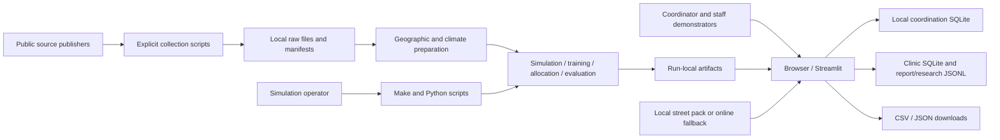
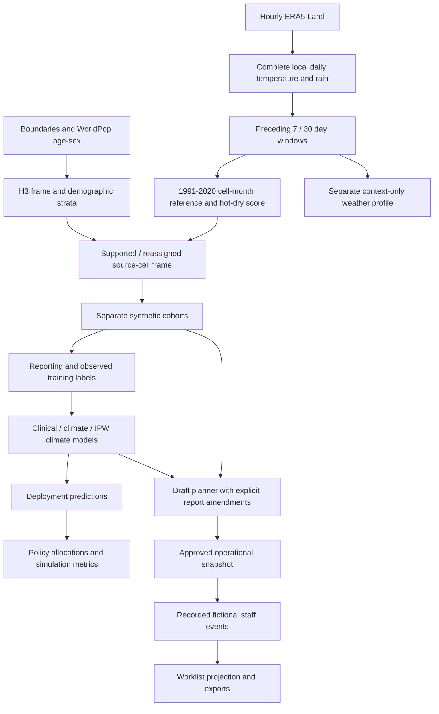
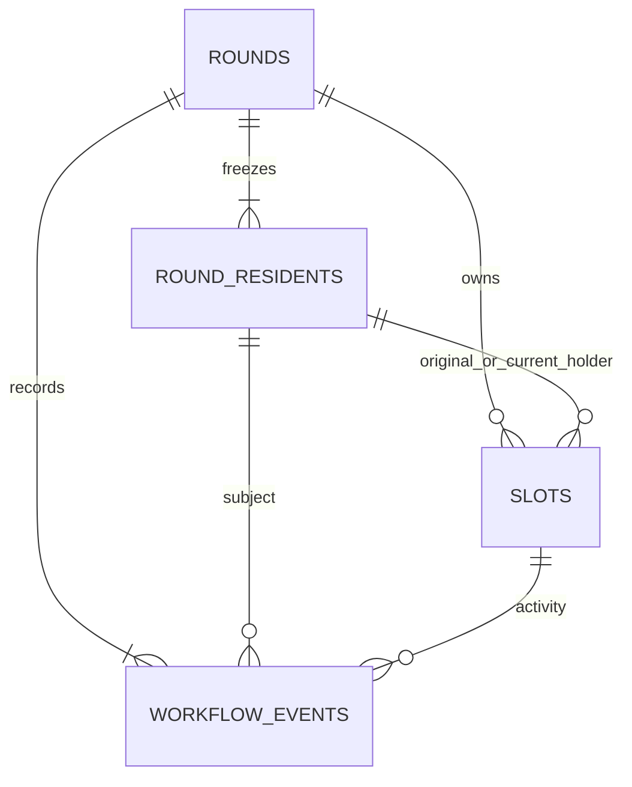
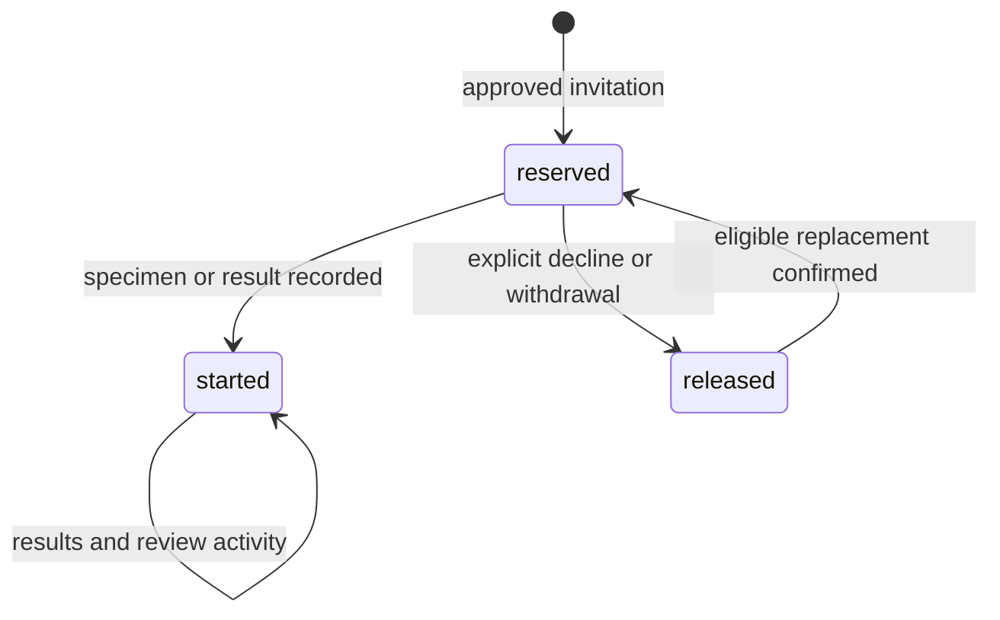

# AGAP-CKD — Current System Architecture

## 1. Baseline and system context

**Documented:** 22 October 2026 (Asia/Manila). **Branch:** `main`. **Commit:** `a88eb9be433923087c47a80848b11bff1cf5798b`. **Package:** `agap` 0.1.0, Python ≥3.10.

This describes the inspected working tree. Git showed a relocated proposal PDF and untracked contributor/research documentation, with no tracked application/configuration edits. Those local documents were considered as context; the application description comes from current source. These two SSOT files are new. Inspection was static: no tests, application, pipelines, source downloads, or benchmarks were executed. The [PRD](PRD.md) defines feature IDs F-001–F-026 and user-visible behavior.

AGAP-CKD is a Python application combining a reproducible simulation pipeline with a local Streamlit screening-planning and fictional staff-coordination workspace. External services supply files during explicit collection/preparation; the normal app reads local run artifacts. There is no separate HTTP business API, message broker, remote clinical database, or identity service in the inspected implementation. Browser interactions trigger Streamlit Python reruns and direct domain/storage calls.



The configured study province is Laguna; public-mode processing expects matching files. The climate collectors and street pack have a Laguna-specific extent. Fixture mode is illustrative. Resident and clinical data, assumed climate-health effects, hypothetical service points and costs are generated locally. A staff result is manually entered fictional activity, not copied from synthetic hidden truth. [`app/main.py`](../../app/main.py); [`experiment.py`](../../src/agap/experiment.py); [`workflow.py::RESIDENT_FIELDS`](../../src/agap/workflow.py).

## 2. Components and responsibilities

| Component / source | Responsibility and principal dependencies | PRD features |
|---|---|---|
| [`app/main.py`](../../app/main.py) | Streamlit setup, CLI config argument, latest-run checks, cached artifact loading; composes the main workspace and evidence/research/surveillance contents. | F-001, F-019–022 |
| [`walkthrough.py`](../../src/agap/walkthrough.py) | Four-page navigation, shared resident context, draft report/model/plan state, maps, explanations, paired comparisons and simulation evaluation; calls domain helpers. | F-004–012, F-020 |
| [`demo.py`](../../src/agap/demo.py), [`climate_demo.py`](../../src/agap/climate_demo.py), [`model_comparison.py`](../../src/agap/model_comparison.py) | Pure draft transformations, operational projections/exports, saved-model scoring, contribution explanations, matched model comparisons. | F-005–011 |
| [`workflow_ui.py`](../../src/agap/workflow_ui.py) | Approval, worklist actions, save receipts, case selection, replacement confirmation, history/downloads and archive controls. | F-012–018 |
| [`workflow.py`](../../src/agap/workflow.py) | Streamlit-independent snapshot validation, safe operational field allowlists, event normalization, worklist projection and replacement selection. | F-012–018 |
| [`workflow_store.py`](../../src/agap/workflow_store.py) | SQLite schema v1, transaction boundaries, immutable approval snapshots, append-only events, request idempotency and optimistic versions. | F-012–018 |
| [`workflow_overview.py`](../../src/agap/workflow_overview.py), [`workflow_presentation.py`](../../src/agap/workflow_presentation.py) | Read-only case aliases, due-date browsing, queue counts, next-case selection, recorded progress and recovery facts. | F-016/017 |
| [`experiment.py`](../../src/agap/experiment.py) | Run identity, artifacts, main stages, synthetic cohorts, sklearn fitting, allocation, evaluation and stage orchestration. | F-001–003/006/009/020/026 |
| [`config.py`](../../src/agap/config.py), [`cli.py`](../../src/agap/cli.py) | Recursive YAML inheritance; stage entry points; repeated scenarios, exact completed-run reuse and paired summaries. | F-001/025 |
| [`data/geography.py`](../../src/agap/data/geography.py), [`data/sources.py`](../../src/agap/data/sources.py) | Fixture/public frame generation, conservation, hypothetical facilities, metadata families and manifest enrichment. | F-002/003/019/026 |
| [`climate/history.py`](../../src/agap/climate/history.py), [`climate/integration.py`](../../src/agap/climate/integration.py), [`climate/available.py`](../../src/agap/climate/available.py) | Hourly decoding, local daily/window processing, reference statistics, supported geography, run snapshots, and separate baseline-free weather context. | F-002/003/010/011/021/023 |
| [`reports.py`](../../src/agap/reports.py), [`simulate/kidney.py`](../../src/agap/simulate/kidney.py), [`models/leakage.py`](../../src/agap/models/leakage.py) | Shared report schema/legacy revision log, kidney computations/missing-safe labels, model-feature checks. | F-004/005/006/014 |
| [`community_map.py`](../../src/agap/community_map.py), [`basemap.py`](../../src/agap/basemap.py), [`mapping.py`](../../src/agap/mapping.py), [`visuals.py`](../../src/agap/visuals.py) | Plotly/pydeck maps, local style resolution, municipality geometry, charts and presentation helpers. | F-008/010/011/020/021 |
| [`decision_support.py`](../../src/agap/decision_support.py), [`integrity.py`](../../src/agap/integrity.py) | Operational chips versus hidden evaluation, saved safeguard summaries, artifact reference/range checks. | F-020/026 |
| [`longitudinal.py`](../../src/agap/longitudinal.py), [`spatial.py`](../../src/agap/spatial.py), [`surveillance.py`](../../src/agap/surveillance.py) | Separate follow-up simulation, aggregation sensitivity and monthly synthetic surveillance/forecasting. | F-021/023/024 |
| [`research.py`](../../src/agap/research.py), [`clinics.py`](../../src/agap/clinics.py), [`clinic_ui.py`](../../src/agap/clinic_ui.py) | Independent voluntary-interest/matching demonstration; facility fact validation, SQLite revisions and verification form. | F-019/022 |

`src/agap/allocation/`, `models/`, and `evaluate/` contain package markers, but main fitting/allocation/evaluation functions currently reside in `experiment.py`. `app/workspace.css` controls appearance and responsive layout; `.streamlit/config.toml` enables local static serving. `notebooks/` is exploratory, not a runtime entry point.

## 3. Execution paths

### Local setup and commands

From the repository root, the documented setup is `python3 -m venv .venv`, activate it, then `pip install -r requirements.txt`. The editable `agap` package is found under `src/`. The Makefile defaults `PYTHON` to `.venv/bin/python` and exports the repository's `src` directory through `PYTHONPATH`.

| Command | Current execution |
|---|---|
| `make all CONFIG=config/params.yaml` | `scripts/run_pipeline.py` → `cli.main('all')` → `experiment.execute`; runs all nine stages in order. |
| `make data`, `simulate`, `train`, `allocate`, `evaluate`, `spatial`, `longitudinal`, `surveillance`, `integrity` | Matching script → `cli.main(stage)` → that stage only. Upstream artifacts must already exist. |
| `make demo CONFIG=...` | Streamlit `app/main.py`, headless server on localhost, usage collection disabled, configuration forwarded after `--`. |
| `make demo-guided CONFIG=...` | Same app with `AGAP_WORKFLOW_DB` set from `WORKFLOW_DEMO_DB`, defaulting to an isolated guided database. |
| `make experiments CONFIG=config/fast.yaml` | Nine mechanism/odds-ratio scenarios × `prototype.repetitions`; matching complete runs reused; paired summaries saved. |
| `make collect`, `make prepare-public` | Download demographic/reference sources and prepare the public temperature view, verification queue and municipal boundaries. Separate from normal pipeline. |
| `make collect-climate-arco`, `make collect-climate`, `make prepare-climate` | Explicit source acquisition and historical climate processing; default climate profile reads the bundled ARCO extract. |
| `make prepare-weather`, `make collect-map`, `make manifest` | Prepare baseline-free weather; collect bounded display assets; refresh source metadata without downloading. |
| `make test`, `make verify-browser`, `make benchmark` | Existing test, browser and performance entry points; not executed for these documents. Browser dependencies are separate in `requirements-browser.txt`. |

Sources: [`Makefile`](../../Makefile), [`cli.py::main`, `experiments`](../../src/agap/cli.py), [`scripts/run_pipeline.py`](../../scripts/run_pipeline.py). The Makefile's `clean` target removes selected processed/synthetic/figure/table contents; it is not a general database or run-history reset.

### App startup and an interaction

1. `config.load_config` resolves the chosen YAML or `config/params.yaml`.
2. `app/main.py` reads `outputs/latest_run.json`, requires manifest/deployment/facilities/clinical-model files, and checks the requested configuration fingerprint.
3. It requires data/simulate/train/allocate/evaluate statuses `complete`. Requested weather or climate snapshots must load. A different package source hash displays a refresh warning.
4. Cached loaders read Parquet, JSON and locally generated Joblib models. `render_walkthrough` loads an active round for the same run, restores explicitly applied amendments, builds the working cohort, and scores it.
5. A UI action updates Streamlit state or calls a domain/storage operation. Plan comparison calls `demo.compare_plans`; approval calls `build_round_snapshot` then `workflow_store.create_round`. A worklist save normalizes the event, commits SQLite changes and reruns from persisted state.

The Prepare demo control invokes the pipeline, but normal reruns read saved artifacts. Model artifacts are trusted local files generated by this project; `demo.load_demo` does not accept arbitrary uploaded pickles.

## 4. Data sources and lineage

Source URLs below are repository-recorded provenance, not independently revalidated web sources. Detailed file retrieval/checksum/license metadata is in [`data/manifest.yaml`](../../data/manifest.yaml), [`docs/data_sources.md`](../../docs/data_sources.md), and source-specific sidecars. `data/sources.py::REQUIRED_FIELDS` defines required provenance fields. Model feature lineage is described in §5.

| ID / family | Publisher, coverage and representation | Acquisition → derived data → consumers | License/provenance in repository |
|---|---|---|---|
| **D-01 Boundaries** | geoBoundaries gbOpen Philippines ADM2 province / ADM3 municipality-city; represented year 2020; EPSG:4326 simplified polygons. [ADM2](https://www.geoboundaries.org/api/current/gbOpen/PHL/ADM2/), [ADM3](https://www.geoboundaries.org/api/current/gbOpen/PHL/ADM3/). | `collect_data.py` → `data/raw/boundaries/PHL_ADM{2,3}_simplified.geojson` plus release metadata → `public_geography` / `municipal_features` → study mask, municipality association, display outlines; F-002/007/008/024. | Source release metadata and `docs/data_sources.md` record CC BY 3.0 IGO; not legal survey geometry. |
| **D-02 Population** | WorldPop Global 2000–2020 unconstrained top-down 2020 estimates; ~1 km/30 arc-seconds, persons per sex/age-band pixel, EPSG:4326. [Age–sex index](https://data.worldpop.org/GIS/AgeSex_structures/Global_2000_2020_1km/unconstrained/2020/PHL/). | `collect_data.py --demographics` → 28 rasters, F/M and 15–19…80+ → provincial clipping/H3 aggregation → sampling strata, represented-adult weights, municipal allocation shares; F-002/003/009. Separate all-age aggregate raster is downloaded/reference material, not the simulator's population input. | CC BY 4.0 as recorded in manifest; modeled counts, not resident addresses or current population observations. |
| **D-03 Climate/weather** | C3S/ECMWF ERA5-Land hourly 2 m temperature and precipitation; 0.1° grid, bbox N/W/S/E `14.7/120.9/13.8/121.7`. Local extract December 1990–September 2026 UTC. [Dataset](https://cds.climate.copernicus.eu/datasets/reanalysis-era5-land). | `collect_climate_arco.py` → checksummed yearly Parquet/JSON in `data/raw/era5_land/arco/`; alternate `collect_climate.py` → CDS GRIB ZIPs. `prepare-climate` → daily/exposure/baseline tables → frame coverage and saved-date scores/simulation. `prepare-weather` uses intersecting CDS archives → context-only daily/windows. F-003/006/010/011/021/023. | Manifest records CC BY 4.0 and modified C3S attribution. ARCO store URLs/checksums/retrieval dates retained in its JSON. Source grids retain lake/sea missingness. |
| **D-04 Synthetic frame, facilities and parameters** | Local fixture geometry or D-01/D-02 population; configured generative distributions, not imported patient records. | `fixture_geography` / `make_geography` and `simulate_cohort` → cells, strata, `SIM-*` service points, cohorts, traits, labs, observation history → model training and simulation comparisons. Municipal service points use population-center cells and equal assumed capacity. F-002/003/009/012/020–025. | `config/params.yaml` and `config/parameter_register.yaml` identify source-supported, derived and assumed parameter origins. Reproducible seeds retained in run metadata. |
| **D-05 Reports and staff records** | Fictional form/SMS-style reports and manually entered demonstration actions. | `reports.normalize_report` / `workflow.normalize_event` → report JSONL or round SQLite events → draft model-visible amendments and worklist projection. F-004/005/012–018. | Schema versions, event/revision links, UTC recording time and data-status labels. A report's prior-test/hour fields are recorded without becoming current predictors. |
| **D-06 Facility identities/facts** | PhilHealth YAKAP register, header dated 30 September 2026; names and source pages, not verified coordinates/capacity. [Official PDF](https://www.philhealth.gov.ph/partners/providers/facilities/accredited/YAKAP.pdf). | `collect_data.py` → `data/raw/philhealth/YAKAP.pdf`; `prepare_public_data.py::clinic_rows` → `clinic_verification_queue.csv` → `clinics`/`clinic_ui` collect dated checked facts in SQLite. F-019. Does not feed `make_geography` facilities or the allocator. | Redistribution terms not established in manifest. Catalog IDs use `YAKAP-20260930-<source_row>`. Parsed worksheet excludes staff contacts. |
| **D-07 Street display** | OpenFreeMap Liberty style using OSM/OpenMapTiles, local bbox `[120.75,13.75,122.0,14.95]`, zooms 7–12. [Style](https://tiles.openfreemap.org/styles/liberty). | `collect_basemap.py` → local style, 379 tiles, glyphs, sprites and manifest in `app/static/maps/laguna/` → pydeck display only; F-008. Inspected manifest: 407 assets, 14,925,503 bytes, collected 20 October 2026. | OSM attribution/ODbL and component notices retained with local pack. Basemap places/roads never verify laboratories or compute route distance. |
| **D-08 Aggregate/method references** | DOST-FNRI 2023 NNS results in 2024 Nutrition Summit Part 2; published kidney-function and measurement-variability references recorded by the project. [FNRI deck](https://enutrition.fnri.dost.gov.ph/uploads/2024%20National%20Nutrition%20Summit_Part%202.pdf). | Collected deck → manually specified age-group high-fasting-glucose percentages → `calibrate_traits.py` target and bisection → configured `simulator.traits.dm_intercept`. `simulate/kidney.py` implements CKD-EPI 2021. Follow-up reference values are encoded in longitudinal config. F-003/014/023. | FNRI redistribution terms not established. The fasting-glucose proxy is not self-reported diagnosed diabetes; other trait/behavior coefficients remain configured simulator values. Sources/classification in parameter register and longitudinal design. |
| **D-09 ENSO reference** | DOST-PAGASA ENSO Advisory No. 7, 5 January 2024, national narrative PDF. [Advisory](https://pubfiles.pagasa.dost.gov.ph/pagasaweb/files/climate/elninolanina/01052024_ENSO_Advisory7_OS.pdf). | `collect_data.py` → local PDF/manifest → source-readiness/reference display. It is not a predictor and is not joined as a complete historical ENSO series. F-020. | Publication date/source retained; redistribution terms not established in manifest. |

### Public geography transformation

`data/geography.py::public_geography` selects one province by case-insensitive name. It retains municipalities whose representative point falls within the buffered province. Positive unmasked age–sex raster pixels are clipped with rasterio and assigned by pixel center to H3 resolution 8. The 15–19 band contributes 0.4 of its count as adults 18–19. Older bands remain five-year strata except 80+, from which ages are drawn uniformly over 80–95. A border H3 center outside municipal polygons takes the closest polygon.

`population_check` requires relative difference between clipped source, demographic and H3 totals ≤`1e-6`. Each cell receives its resolution-7 parent and a nearest rounded 0.1° source identifier. Hypothetical service points are chosen near each municipality's population-weighted center; no facility-register coordinate is read. Fixture mode generates a rectangle with five longitudinal zones and uniform artificial age–sex mass, rather than ingesting these sources.

### Historical climate transformation

`climate/history.py` decodes source hours. Temperature converts K→°C. CDS accumulated rainfall is differenced within forecast cycles, m→mm; ARCO rainfall is already hourly. Rounding noise down to −0.001 mm is clipped to zero; more negative rain stays missing. Temperature is grouped by Asia/Manila calendar day; a rain interval ending exactly at midnight belongs to the preceding day. Each variable requires 24 observations; an incomplete variable stays missing.

`build_exposure` calculates preceding 7-day descriptive and 30-day windows, shifted one day so the cutoff date is excluded. The 1991–2020 reference groups complete 30-day windows by source cell and cutoff calendar month. Every reference year/month needs at least 90% complete windows. Let `T` be the 30-day mean of daily maximum temperature, `R` the 30-day rainfall total, and `μ`/`s` their baseline means/sample SDs:

```text
z_temperature = (T - μT) / sT
z_rain_deficit = (μR - R) / sR
hot_dry_score = (z_temperature + z_rain_deficit) / 2
```

SD below `1e-8` uses a unit scale and is flagged. This is an equal-weight descriptive index, not a re-standardized unit-normal variable or humidity-based heat index. An incomplete window/reference has no valid score.

`climate/integration.py::snapshot_climate` requires a source cell to have at least 95% complete cutoff dates in **each** train/validation/deployment period. Unsupported H3 source assignments can take the nearest supported land source within 15 km by default, preserving original cell and reassignment distance. Remaining unsupported population is excluded; coverage and represented-population fractions are saved in `climate_frame.json`. At least five supported source groups are required. Residents are sampled on complete dates within their assigned partition, without climate interpolation.

Daily, exposure, baseline and metadata files are copied into the run. `climate/available.py` independently prepares 7/30-day descriptive windows for 2021–2024 from downloaded CDS archives, without a baseline, anomaly or hot–dry score. That mode supplies weather context only.



## 5. Models and decision algorithms

### Cohorts and observation process — F-003

`experiment.py::simulate` holds out `ceil(20% × populated source groups)` selected by a seed/repetition stream. Training/validation use remaining groups; deployment uses held-out groups. Cohorts contain different resident IDs and have independent configured sizes, not fractions of a single cohort. Dates are constants in `climate/integration.py::PARTITION_DATES`:

| Partition | Dates | Default cohort |
|---|---|---:|
| Training | 1 January 2021–31 December 2023 | 3,000 |
| Validation | 1 January–31 December 2024 | 1,500 |
| Deployment | 1 January 2025–30 September 2026 | 3,000 |

Strata are sampled proportional to adult count. Each resident represents equal mass `selected_frame_adults / cohort_size`; stored municipal totals refer to the selected partition's represented population. The design evaluates jointly later dates/unseen source groups under the simulator.

Diabetes/hypertension traits use configured logistic generators; family history/outdoor work use configured Bernoulli rates. For age centered at `simulator.age_center` (40), the synthetic outcome probability is:

```text
sigmoid(outcome_intercept + age_coefficient × (age - 40)
        + dm_coefficient × dm_true + htn_coefficient × htn_true
        + family_coefficient × family_true + outdoor_coefficient × outdoor_true
        + log(heat_or) × hot_dry_score)
```

The default heat OR is 1.2 per score unit. Fixture exposure is a synthetic annual sine plus source-cell phase; it is not public weather. Conditional laboratory synthesis uses renal/albumin subtype draws, target eGFR ranges, inverse CKD-EPI creatinine and lognormal uACR; recomputation must agree with the generated abnormal flag. Default outcome is eGFR `<60` or uACR `≥30`.

MCAR reporting/invitation/completion omit trait effects. MAR reporting varies with age/distance and completion with distance; Round-0 invitation also depends on report state/proximity. MNAR additionally uses hidden outcome in reporting/completion. Probabilities are clipped to `[0.03,0.97]` by default. The stored observation probability marginalizes report status:

```text
P(observed label) = ((1 - P(report)) × P(invite | no report)
                    + P(report) × P(invite | report)) × P(complete)
```

Only Round-0 completed tests provide observed train/validation labels. Deployment labels are cleared. Late report answers are masked at cutoff. Prior-test/hour/date simulation uses a separate random stream. See `simulate_cohort`, `add_report_details`, `rng_for` in [`experiment.py`](../../src/agap/experiment.py).

### Fitted scoring and threshold behavior — F-006/010

`experiment.py::MODELS` explicitly defines:

| Model | Predictors | Weighting / exposure in UI |
|---|---|---|
| `clinical` | `age`, `female`, `dm_report`, `htn_report`, `family_report`, `outdoor_report` | Unweighted; live Questionnaire only. |
| `climate` | Clinical predictors + `hot_dry_score` | Unweighted; live Questionnaire + climate only with loaded historical climate snapshot. |
| `ipw_climate` | Same climate predictors | Simulator-known inverse observation weights; saved experiment model, not a live planner selector. |

A `ColumnTransformer` median-imputes values with empty features retained, standardizes them, and adds a missingness indicator for every feature. A scikit-learn `LogisticRegression(C=1.0,max_iter=500)` fits observed training labels. Feature allowlists and forbidden clinical/hidden/future/research fields are checked before fitting. IPW weights `1/p` are capped at the configured 99th percentile and normalized to mean one; support/ESS are exported. MNAR weights are labeled oracle.

`train` computes thresholds for **both 80% and 90% target sensitivity**, using observed validation labels only. At least two classes and ten observed positives are required by default; otherwise threshold and flag stay undefined with an unsupported status. It chooses the highest finite ROC threshold reaching the target. Deployment predictions include score, threshold, flag, cutoff, model/source version and completeness. Saved evaluation reports AUROC, AUPRC, Brier, sensitivity, specificity, FNR and fitted calibration intercept/slope for all deployment residents and reporters. These use hidden synthetic truth.

`climate_demo.score_cohort` reuses saved models without fitting. Stable stored tie draws rank descending scores. Exact additive explanations combine transformed value and missingness coefficients in log-odds space. `preview_at_date` changes only model-visible climate input and excludes unsupported residents from both comparison denominators; saved cutoff/outcome remains fixed.

### Allocation — F-009/010/017

`experiment.allocate_policy` validates finite scores, budget and capacity; computes haversine distance; and restricts invitations by available capacity and configured access limit (default 20 km). Allocation is score-ranked, not threshold-gated. Supported policies are random, population-proportional, risk-ranked, and risk plus exploration.

- Risk uses descending score with stored ties. Mixed allocation takes rounded `budget × share` random slots first, then fills by risk.
- Proportional allocation computes largest-remainder municipality quotas from represented-adult totals, iterates a seeded random queue and reassigns feasible shortfalls.
- Configured municipal minimums are checked first, including a maximum-flow test for shared capacity. The greedy nearest-point assignment must also meet them; failure stops rather than relaxing the constraint.
- Each selected resident receives the nearest remaining in-limit service point. Greedy processing can leave budget unused. Conditional invitation probabilities are left undefined rather than inferred.
- Simulated completion uses resident-shared uniforms. MAR/MNAR completion probability adjusts for assigned-versus-nearest distance. All comparative plans use the same cohort/draws.

`experiment.allocate` and `spatial.sensitivity` explicitly run six variants: random, proportional, pure risk, risk+10%, risk+20%, risk+30%. Saved pipeline allocation uses the **unweighted `climate` model scores** selected from its 90%-target prediction records; its threshold is not used to select invitations. This also applies to fixture/public runs where the exposure is synthetic. The live planner instead uses the selected clinical or historical-climate scores and three strategies from `demo.STRATEGIES`; random is its comparison baseline.

`allocation_metrics` separates access-excluded, feasible/uninvited and invited/incomplete hidden positives; reports detection yield per completed panel, completion coverage of the eligible cohort and access-feasible cohort, subgroup counts, represented counts and assumed completed-panel costs. Default panel cost is ₱500. The simulation does not reassign noncompleted invitations; explicit declined-slot recovery belongs to the separately persisted coordination workflow.

### Supporting algorithms — F-021–025

| Capability | Current implementation |
|---|---|
| Paired model comparison | `model_comparison.compare_models` changes model scores only, computes actual invitation-set additions/removals and separate hidden-truth diagnostics. Calibration uses fixed-width bins without refitting the model. |
| Spatial sensitivity | `spatial.located_at` moves the same residents to resolution-8 / resolution-7 parent centers. Scores, outcomes and uniforms stay fixed; nearest reference distances and six policy allocations are recomputed. |
| Longitudinal simulation | `longitudinal.simulate_followup`: defaults 90/180 days, mean-one lognormal variability (creatinine CV .05, uACR .30), eGFR decline 1/year, hypothetical acute-event rate .02 and creatinine multiplier 1.5. Persistent = initially abnormal and abnormal at configured persistence day, among residents with all follow-up exposures. Observed follow-up uses simulated attendance. This never populates staff-entered records. |
| Monthly surveillance | `surveillance.simulate_panel`: fresh 1,000-resident samples across January 2021–September 2026; municipality/province observed/hidden counts and denominators. Target is abnormal flags per 100 tested. Forecasts use last 12 months, rolling origins at 1/3 months, seasonal naïve `y(t-12)`, regression with lagged positivity, and a matching regression adding origin hot–dry score. At least six training rows; hidden columns rejected. Metrics: MAE/RMSE and separate regression/climate gains. |
| Research matching | `research.eligibility`: age ≥40 and reported DM or HTN. `comparison_cohort`: eligible/latest interested, known outdoor answer, 1:1 outdoor/non-outdoor matching within 40–49/50–59/60–69/70+ and sex. Separate interest stream/manual events do not enter screening. |
| Repeated experiments | `cli.experiments`: nine MCAR/MAR/MNAR × OR 1.0/1.2/1.5 combinations, repetitions from `prototype.repetitions`; paired differences against random for detections, yield and completion coverage. Emits between-repetition SD, MCSE, mean±1.96×MCSE and empirical repetition quantiles. |

## 6. Records, storage, and lifecycle

Current contracts below follow writers/readers in source. `docs/data_contracts.md` supplies historical context; its older filenames and `person_id` schema are not the current runtime layout.

### Run-local artifacts

| Record / artifact | Keys and principal content |
|---|---|
| `manifest.json` | Run/config/source/input identity; full configuration; seed/repetition; Git commit; selected package versions; start time; per-stage status; source-mode labeling. |
| `cells.parquet`, `demographics.parquet`, `facilities.parquet`, `boundary.geojson` | `h3`; `h3,female,age_start`; `facility_id`; boundary geometry. Population, municipality, coordinates, source-cell mappings and hypothetical capacity. |
| `population_check.json`, `split.json`, `climate_frame.json` | Conserved population totals, held-out source groups, supported/reassigned climate frame and source checksums where applicable. |
| `train_hidden.parquet`, `validation_hidden.parquet`, `deployment_hidden.parquet` | Per-partition `resident_id`, H3/source cell, age/sex, cutoff, report/true traits, labs/outcome, representation weight, observation probabilities and paired uniforms. IDs such as `SYN-DEPLOYMENT-000000` are unique within the run/partition context. |
| `climate_daily.parquet`, `climate_exposure.parquet`, `climate_baseline.parquet`, `climate_metadata.json` | Optional historical snapshots; daily key cell/date, exposure key cell/cutoff, baseline key cell/calendar month. |
| `weather_daily.parquet`, `weather_windows.parquet`, `weather_metadata.json` | Optional baseline-free weather snapshots, including independent 7/30-day completeness. |
| `model_{clinical,climate,ipw_climate}.joblib` | Locally trained preprocessing/model pipelines. |
| `predictions.parquet`, `model_metrics.csv`, `weight_diagnostics.json` | Prediction key resident/model/target sensitivity; thresholds/status; model and weighting diagnostics. |
| `allocations_hidden.parquet`, `coverage_check.json`, `metrics.csv` | Per policy/resident assignment, completion/evaluation truth, access/selection reason, capacity/coverage checks and subgroup metrics. |
| `efficiency_coverage.png`, `report.html` | Saved synthetic detection-yield/reach chart and HTML report page referencing its sibling figure. |
| `spatial_sensitivity.csv/.json` | Policy comparison at H3 8/7, ranking and reach summaries. |
| `longitudinal_hidden.parquet`, `longitudinal_metrics.csv`, `longitudinal.json` | Resident follow-up measurements, inclusion, persistent/transient labels, policy metrics and generator settings. |
| `surveillance_monthly.parquet`, `surveillance_forecasts.parquet`, `surveillance_forecast_metrics.csv`, `surveillance.json` | Monthly summary key month/municipality, rolling forecasts, errors and source/scenario metadata. |
| `integrity.json` | Checks performed, passed count and missing optional files skipped. |

All reside under `outputs/runs/<run-id>/`. Repeated summaries are separate: `outputs/experiments/<config-hash>-<source-hash>/{replications.csv,paired_differences.csv,manifest.json}`. The repeated-summary folder name omits the run-level input hash; underlying individual runs retain it. Sources: `experiment.py`, `cli.py`, and each stage writer.

### Local operational storage

Default database: `data/reports/screening_workflow.sqlite3`. `workflow_ui.workflow_path` accepts trusted server environment `AGAP_WORKFLOW_DB`; browser parameters do not select the database. Four schema-versioned tables implement coordination:

| Table | Identity / content |
|---|---|
| `rounds` | `round_id` UUID, `run_id`, active/archived status, optimistic version, immutable settings/snapshot JSON, creation/archive UTC timestamps. A partial unique index permits one active round per run. |
| `round_residents` | Composite round/resident key; immutable allowlisted operational resident snapshot. Includes frozen candidate distances, scores and priority/random ranks, not hidden outcomes. |
| `slots` | Composite round/slot key; original/current resident, frozen service point/municipality/reason/ordering basis, mutable reserved/started/released state and version. Unique index prevents two current occupied slots for the same resident. |
| `workflow_events` | Autoincrement recording sequence, UUID event, unique request ID and request-content fingerprint, round/resident/slot references, actor, occurrence/recording UTC times, JSON payload, optional superseded event ID. Append-only triggers reject update/delete. |

`build_round_snapshot` freezes all candidates, facilities, original invitations and priority/random/policy orders, plus model/settings and selected provenance. Explicit field allowlists exclude hidden health outcomes, simulator completion outcomes and research fields. The original run's source hash and current package source hash are stored separately. Snapshot normalization validates finite scores/distances, known entities, order membership, access, reasons and capacities.



`workflow.project_worklist` folds recording sequence, not backdated occurrence time, into current cases. It retains former slot holders after replacement. Report-attempt events do not apply answers; `report_applied` explicitly amends the working draft. Only actual recorded events create contact/specimen/results/review state.



A specimen/result consumes its slot. The UI requires specimen collection before entering results; domain validation also supports recording a result with its specimen date. A round has one specimen episode per resident. Result revisions use `supersedes_event_id`; review remains open until explicitly addressed. Contact/review/task dates are staff-entered; future specimen dates are rejected.

Observed abnormality uses `observed_screen_label`: any observed eGFR `<60` or uACR `≥30` flags; both observed normal yields negative; otherwise unknown. Missing inputs needed for eGFR remain unavailable and can open review. These are recorded initial flags, not disease clearance. Queue precedence is open review/follow-up, then declined/former holder, then completed panel, then accepted/started awaiting screening, otherwise contact needed.

Replacement scans the frozen ordering basis for a never-assigned resident in the same municipality and assigned facility within the saved distance limit. It does not rescore, reallocate globally or use simulator outcomes. `confirm_replacement` recomputes the proposal under a write lock, checks round version/slot status and atomically records assignment. Archive ends new writes but retains events and exports.

### Other local records

- `data/reports/citizen_reports.jsonl`: pre-round schema-v2 envelopes, raw SMS when present, validity/errors, event date versus availability timestamp, previous-attempt and valid-supersession links. Equivalent consecutive normalized attempts deduplicate across channels. Assumes a single local writer.
- `data/reports/clinic_verifications.sqlite3`: `clinic_verifications` sequential revisions with facility ID, UTC availability, validated fact JSON, fingerprint and previous revision. Immediate transaction and identical-save deduplication. Status derives from dated coordinates, component availability and positive panel capacity. Never replaces run facilities automatically.
- `data/reports/<run-id>/research_events.jsonl`: manual research-interest changes, eligibility/rule version and recording time. Latest manual state follows simulated initial events. This is separate from coordination events.

Sources: [`workflow_store.py::_SCHEMA`, `record_event`, `confirm_replacement`](../../src/agap/workflow_store.py); [`workflow.py::_state`, `normalize_event`](../../src/agap/workflow.py); [`reports.py`](../../src/agap/reports.py); [`clinics.py`](../../src/agap/clinics.py); [`research.py`](../../src/agap/research.py).

## 7. Configuration and runtime modes

`config.py::load_config` resolves `extends` relative to the child YAML and recursively merges nested dictionaries; scalar/list overrides replace their parent values. `ROOT` is resolved from package location. Top-level default `n_repetitions` is not the experiment-loop selector: execution uses `prototype.repetitions`. Actual model variants, 80/90% threshold targets and six saved policy variants are explicit in current code.

| Profile | Inherits / current effect | Public inputs and live model behavior |
|---|---|---|
| `params.yaml` | Default fixture; train/validation/deployment 3,000/1,500/3,000; repeated suite 5/scenario. | Illustrative geometry/artificial exposure; live questionnaire-only. Saved pipeline still fits all three models with fixture exposure. |
| `public.yaml` | Extends params; sets geography mode public. | Collected boundaries/age–sex required; exposure remains synthetic; live questionnaire-only. |
| `weather_preview.yaml` | Extends public; enables `data/processed/weather/laguna`. | Public geography and run-local real weather context; no seasonal exposure predictor is supplied by this mode. Live questionnaire-only. |
| `climate.yaml` | Extends public; ERA5-Land mode, source `arco`; `data/processed/climate/laguna`; 95% partition coverage, ≤15 km reassignment. | Public geography plus prepared reference/replay; live clinical and unweighted climate choices. Missing inputs fail explicitly. |
| `fast.yaml` | Extends params; sizes 2,000/1,000/2,000; 5 repetitions. | Fixture modes inherited. |
| `full.yaml` | Extends params; sizes 10,000/5,000/10,000; 200 repetitions. | Fixture modes inherited. |

Shared defaults include seed 2026, 500 panels, 100 slots/hypothetical facility, 20 km access, no municipal minimum, assumed ₱500/completed panel, MAR, heat OR 1.2, report rate .30 and baseline completion .70. Live draft controls initially use `min(500,cohort size)` and 20% mixed outreach, then save their submitted comparison settings in session state.

Inspection found a latest saved fixture run at `outputs/runs/31eeb9a6f51e-9ee5da3833af-44136fa3`; its manifest records all stages complete. The separate local processed-climate directory contained metadata but no required daily/exposure/baseline Parquet files at inspection. Configuration support for the climate profile is implemented; app startup still requires its prepared artifacts. This describes local runtime prerequisites, not a pipeline run performed here.

## 8. Cross-cutting behavior

### Reproducibility and artifact publication

`experiment.run_path` uses a 12-character canonical-config SHA-256 prefix, a 12-character hash over relative names/content of `src/agap/**/*.py`, and an 8-character hash of configured input checksums. The source hash does not cover every UI/script/dependency file. Public checksums cover age–sex rasters/boundary GeoJSON, plus applicable processed climate/weather inputs. `rng_for` derives independent component streams from repetition, component and seed; paired plans share ties/completion draws.

`execute` records stage `running`, `complete` or typed `failed` status and re-raises failures. It publishes `outputs/latest_run.json` when core data/simulate/train/allocate/evaluate are complete. Full execution order is data → simulate → train → allocate → evaluate → spatial → longitudinal → surveillance → integrity. Single-stage execution does not automatically run dependencies.

Designated text/Parquet/model writers publish via temporary file and replacement; some CSV and supplementary metadata writers write directly. `cli.completed_run` reuses an experiment repetition only when config/source/input hashes match, metrics exist, and all nine stages are marked complete. Identical settings can rerun in the same directory; a different config/source/input identity produces a separate run. Saved experiments are not changed by UI what-if edits.

### Concurrency, time, and state

Coordination connections enable foreign keys, a five-second busy timeout and schema-version checking. Writes use `BEGIN IMMEDIATE`, committing event/slot/version updates together or rolling back. Reused request IDs return the earlier operation only when the request fingerprint matches. Expected round versions detect stale forms. SQL triggers protect snapshots, slot origins and append-only event history. An eight-entry cache validates identical immutable snapshot JSON; live versions/events remain read from SQLite.

SQLite serialization does not supply authenticated user control or a distributed deployment service. Clinic storage has its own immediate transactions; legacy report/research JSONL lacks the coordination store's concurrency guarantees. Pipeline temporary filenames also do not establish multi-process writer support.

Weather calculations use Asia/Manila dates; exposure windows exclude cutoff day. Staff event occurrence/recording timestamps are stored in UTC and displayed in Asia/Manila. Report schema distinguishes event date and availability; historical experiment inputs stay frozen when current what-if answers are applied. Staff work queues follow recording sequence and explicit due dates rather than score rank.

### Failure, integrity, and display

Missing required public or climate sources fail rather than substituting fixtures. Unknown questionnaire fields stay distinct in stored payloads; missing model inputs are imputed only within the fitted pipeline. Incomplete climate is not imputed into a complete exposure; undefined rates/thresholds remain missing. `integrity.check_run` validates references, policy membership, unique keys and value ranges, recording skipped optional files. Evidence cards read existing artifacts rather than assuming success.

`basemap_source` checks the local pack's listed asset existence, builds an origin/base-path-specific style through atomic replacement, or returns the remote OpenFreeMap style. Local static serving must be enabled; runtime style generation requires a writable asset directory. Outline maps avoid tile dependencies; 3D/pydeck depends on browser rendering/WebGL. Street assets are visual context only.

### Security, runtime, and verification facilities

Collectors read Copernicus credentials from the user's `.cdsapirc` or `CDSAPI_RC`; local processing of the bundled ARCO extract needs no fresh key. No credentials are required for the local map pack. Structured report IDs reject names/phone identifiers; operational exports/snapshots use explicit field projections. Demo free text is not a general sensitive-data filter. There is no deployed identity/authorization layer in this version.

Core requirements include NumPy/pandas/scikit-learn, h3/rasterio/shapely/geopandas, PyArrow, Streamlit, Plotly/pydeck, SciPy, ecCodes/CDS/Zarr/xarray and pypdf. `requirements.txt` pins Streamlit 1.66.0 and pydeck 0.9.3; most libraries are unpinned. Optional Playwright 1.64.0 is listed separately. The manifest records selected installed package versions, not a complete lockfile.

Read-only inspection found pytest definitions for report equivalence, missing-safe labels, leakage, plan/export filtering, source-cell reassignment, snapshot immutability, transactional rollback, request idempotency, stale versions, competing replacement confirmation and report-amendment replay. Existing browser scripts exercise app actions/maps/layout/offline assets in isolated storage; benchmark scripts measure local server-side timings. None was executed here. `docs/performance.md` records historical measurements and five-second allocation/two-second warm-rerun targets; they are not fresh or universal performance guarantees.

## 9. Directory reference and document ownership

```text
app/                         Streamlit entry point, CSS and local map assets
config/                      base YAML, profile overrides, parameter classification
src/agap/                    domain logic, pipeline, UI helpers and storage
scripts/                     CLI wrappers, collectors, preparers and existing verification tools
data/raw/                    collected/extracted source files and sidecars
data/processed/              prepared public/climate/weather inputs
data/reports/                local operational SQLite and report/research event logs
outputs/runs/                fingerprinted experiment artifacts
outputs/experiments/         repeated scenario summaries
outputs/benchmarks/          existing performance-tool destinations
tests/                       pytest source definitions
docs/                        design, source, workflow and historical implementation documents
research/ssot/PRD.md         current product behavior and feature IDs
research/ssot/ARCHITECTURE.md current mechanisms, schemas, provenance and runtime modes
```

The submitted proposal (pp. 2–5) and SRS v1.0 (pp. 5–8, 13–24) establish historical product intent. The current source references in this document establish the version described. Update these two SSOT documents when product behavior, processing, profiles or persistence changes; preserve feature IDs and keep detailed technical definitions here, linked from the PRD.

These documents describe static repository inspection and existing recorded metadata. They do not assert newly executed tests, offline verification, performance measurements or external clinical validation.
