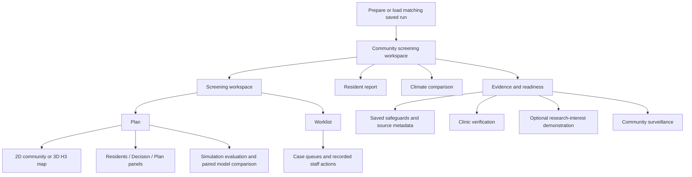

# AGAP-CKD — Current Product Requirements Document

## 1. Documentation baseline

| Item | Current baseline |
|---|---|
| Documentation date | 22 October 2026, Asia/Manila |
| Repository / branch | `agap-ckd` / `main` |
| Git commit | `a88eb9be433923087c47a80848b11bff1cf5798b` |
| Package version | `agap` 0.1.0 (`pyproject.toml`) |
| Version described | Current working tree at inspection; current implementation and configuration establish behavior |
| Relevant uncommitted material | Root proposal PDF moved to `research/decisions/baseline/[00] Project Proposal-1.pdf`; untracked contributor/research documentation included as context. No tracked application/configuration modifications were listed by Git. These SSOT documents are new working-tree files. |
| Inspection method | Static source, configuration, document, PDF, test-definition and existing metadata inspection. No tests, pipelines, downloads, or application sessions were run. |

The local `outputs/latest_run.json` points to fixture run `31eeb9a6f51e-9ee5da3833af-44136fa3`, started `2026-10-22T02:03:53.362083+00:00`; its existing manifest records all nine stages complete. This is a saved record, not a fresh execution result. Default configuration is `config/params.yaml`; the README recommends the separate `config/climate.yaml` demonstration profile. Their behaviors are distinguished below.

The [architecture document](ARCHITECTURE.md) is the canonical reference for algorithms, schemas, sources, storage, and configuration inheritance. This PRD defines the current product behavior. Historical context: [submitted proposal](../decisions/baseline/%5B00%5D%20Project%20Proposal-1.pdf), pp. 2–5; [SRS v1.0](../../AGAP-CKD_Software_Requirements_Specification_v1.0.pdf), pp. 5–8. Current behavior references below take precedence over historical feature descriptions.

## 2. Product overview

**AGAP-CKD** means Atmospheric, Geospatial, Allocation, and Population-level CKD Triage. It is a local simulation and screening-coordination demonstration. It connects questionnaire reporting, public geographic and optional historical climate context, fitted screening models, limited-panel allocation, and recorded fictional staff activities.

The planning problem is how to allocate limited initial kidney-screening panels while examining detection yield, reporting/access barriers, and geographic/subgroup reach. The coordination workspace additionally demonstrates approving a stable invitation round and keeping contact, specimens, results, review, and unused-slot recovery visible. A panel contains creatinine and urine albumin-to-creatinine ratio (uACR).

The intended benefit is a reproducible, explainable comparison and a coherent staff workflow. Scores are model probabilities of a simulated abnormal screening outcome. All residents and medical outcomes are synthetic; facilities, capacities, completion behavior, and costs are hypothetical. Public data do not turn these outputs into validated clinical risks or diagnoses. The climate relationship in outcome generation remains a configured simulator coefficient. [Sources: `app/main.py`; `experiment.py::execute`; `workflow.py::build_round_snapshot`.](../../src/agap/experiment.py)

The configured pilot is Laguna. The UI labels it Laguna, while fixture mode uses an illustrative extent and five fixture zones rather than actual municipal populations. Public mode uses a modeled 2020 population surface and collected administrative boundaries. [Sources: `config/params.yaml`; `data/geography.py::fixture_geography`, `public_geography`; `app/main.py`.](../../src/agap/data/geography.py)

## 3. Users, roles, and access

| Intended actor | Current use |
|---|---|
| Health-planner / LGU coordinator demonstrator | Browse residents, inspect scores, compare whole-cohort plans, approve a round, inspect saved history. |
| Staff demonstrator | Record fictional contact, specimen, result, owner, review, and follow-up activities; confirm an eligible replacement. |
| Citizen-role demonstrator | Submit a form or SMS-style questionnaire for the selected synthetic resident. |
| Simulation operator / data scientist | Prepare sources, configure cohorts/scenarios, execute pipeline stages and repeated comparisons, inspect artifacts. |
| Research-role demonstrator | Record illustrative interest states and export a matched synthetic comparison cohort. |
| Reviewer / judge | Inspect provenance, explanations, saved engineering safeguards and simulation results. |

These are usage roles, not authenticated access levels. The staff actor/owner fields are demonstration labels. There is no application login, role-based authorization, real SMS transport, clinical-system integration, or booking interface in the inspected entry point and coordination UI. [`app/main.py`](../../app/main.py); [`workflow_ui.py::render_worklist`](../../src/agap/workflow_ui.py). Historical role definitions appear in SRS v1.0, p. 7.

## 4. Information architecture

The four top-level pages are **Screening workspace**, **Resident report**, **Climate comparison**, and **Evidence & readiness**. Community surveillance is an expander within Evidence & readiness. Wide layouts use tabs; a compact navigation path offers a page selector. Plan has a map beside Residents, Decision, and Plan panels; responsive controls switch Tasks/Map views. [`walkthrough.py::WORKSPACE_PAGES`, `_page_navigation`, `render_walkthrough`](../../src/agap/walkthrough.py).

The selected resident, municipality/view filters, applied questionnaire amendments, planning model, and committed draft-comparison settings are coordinated through Streamlit session state. Changing view filters does not change allocation candidates or exports. A report or model handoff can relax only filters hiding the followed resident. Switching resident clears the previous resident's report form. Approved rounds use separate persisted state. Reset clears draft selections/comparisons and retains approved history and applied round amendments.

## 5. End-to-end journeys

1. **Prepare and inspect a cohort.** The operator chooses a configuration and prepares a run. The app loads the latest pointer only when required artifacts and configuration match; it provides preparation/refresh controls and explanatory failures. The planner initially has scores but no invitation decisions. Select a map community or filter/search the resident queue, then open Decision to inspect questionnaire completeness, modeled access, score/rank, and available explanations.
2. **Correct a questionnaire.** Select a synthetic resident, open Resident report, enter form answers or SMS-style text, and preview. Validation errors are displayed and retained as attempts. A valid preview shows score/rank effects. Explicitly apply it to update the draft and return to the same resident; prior-screening and outdoor-hours fields are recorded but are not current model predictors. In an approved round, application is a persisted amendment that leaves approved assignments fixed.
3. **Compare and approve a plan.** Choose Questionnaire only or, when available, Questionnaire + climate. Set a whole-cohort budget and strategy, then click **Compare screening plans**. Review assignment reasons and the invited-only export. Simulation evaluation separately compares with random invitations. **Create demo screening round** freezes actual invitations, model/settings, operational candidate data and replacement order, then opens Worklist. No simulated contact, attendance, results, or clinical tasks are prefilled.
4. **Work a case.** Browse/filter work queues, select a case, record contact, then specimen and fictional results. Partial panels remain incomplete. Abnormal observed components create a review task. Record a review disposition, owner, and any explicitly requested follow-up action/date. Complete follow-up explicitly. Saves retain the selected case; **Open next case** advances only on request.
5. **Recover or archive.** A decline before testing releases a reserved slot. Review the proposed same-municipality/service-point replacement and confirm; the original case stays in history. Started panels cannot release capacity. Archive the round to end writes while preserving read-only cases, history and downloads.
6. **Inspect supporting evidence.** Open Climate comparison for saved-date weather and paired model decisions or optional date exploration. Open Evidence & readiness for run metadata, clinic checks, surveillance, and the independent research-interest demonstration. These views do not book appointments or change approved assignments.

Sources: [`walkthrough.py::render_walkthrough`, `_report_step`, `_plan_controls`](../../src/agap/walkthrough.py); [`workflow_ui.py::render_round_approval`, `render_worklist`](../../src/agap/workflow_ui.py).

## 6. Functional requirements and feature catalog

All entries below describe implemented behavior observed in source. Their IDs are local to this PRD. SRS families identify related historical requirements, not a claim of current acceptance-test completion.

Common preconditions: the app requires a matching saved core run; supporting artifacts must exist for optional views. Draft changes remain session-local unless a feature explicitly persists them. Pipeline artifacts live in run directories; local coordination records live outside those directories. Detailed mechanisms are defined in [ARCHITECTURE.md](ARCHITECTURE.md).

### Preparation, reporting, and resident exploration

| ID / purpose and entry point | Inputs, behavior and outputs | State, settings, and failure behavior | Implementation / SRS |
|---|---|---|---|
| **F-001 — Load a reproducible demonstration.** App startup / CLI. | Configuration and saved-run metadata select the cohort and models; preparation produces reusable run artifacts. | Config mismatch or missing core artifacts returns to preparation. Missing requested climate/weather artifacts are explained; a source-hash mismatch prompts refresh. | [`app/main.py::prepare_demo`](../../app/main.py); `experiment.py::execute`; DATA-03/04, NFR-01/03/10/13. |
| **F-002 — Build population and service-point frame.** `make data`. | Fixture or collected boundary/age–sex data becomes H3 cells, demographic strata, population checks, and hypothetical municipal service points. | Resolution, geography mode and assumed capacity are configured. Public inputs must exist; population must be conserved. Climate profile restricts the supported frame. | [`data/geography.py::make_geography`](../../src/agap/data/geography.py); DATA, GEO, FAC. |
| **F-003 — Generate cohorts and observation histories.** `make simulate`. | Population frame and simulator parameters produce separate training, validation and deployment residents, synthetic labs, reports, invitation/completion histories and evaluation truth. | Seed/repetition, cohort sizes, heat effect and MCAR/MAR/MNAR settings govern generation. Deployment has no pre-policy observed labels. Fewer than five populated climate groups stops splitting. | [`experiment.py::simulate`, `simulate_cohort`](../../src/agap/experiment.py); SIM, OBS. |
| **F-004 — Validate form/SMS-style reports.** Resident report. | Synthetic ID and known adult age; optional DM/HTN/family/outdoor/prior-test answers, outdoor hours, event date. Both channels normalize to schema v2. | No/Unknown/Not answered remain distinct in records. Hours 0–168; OUT:N with positive hours is rejected. Dates must be within 30 days and not future. Invalid attempts, revisions and equivalent-submit deduplication are retained. | [`reports.py::normalize_report`, `parse_sms`, `append_report`](../../src/agap/reports.py); E1-01–10. |
| **F-005 — Preview/apply report effects.** Resident report → screening handoff. | Valid selected-resident answers recalculate current model scores and whole-cohort draft comparisons. Explicit Apply updates model-visible questionnaire fields. | Known age is fixed; hidden outcomes and saved experiments remain unchanged. Pre-round attempts use JSONL; round attempts/applications are separate SQLite events. Only applied round amendments restore on reload. | [`walkthrough.py::_report_step`, `_apply_report_and_return`](../../src/agap/walkthrough.py); `demo.py::with_report`; E1, E3. |
| **F-006 — Score, rank and explain residents.** Decision panel. | All cohort adults, including nonreporters, receive questionnaire-model scores; complete climate runs additionally expose the climate model. Exact fitted log-odds contributions explain value/missingness terms. | Saved training-fitted preprocessing handles missing questionnaire values; stable stored ties determine ranks. Scores are simulated-outcome probabilities, not clinical risk tiers. | [`climate_demo.py::score_cohort`, `model_contributions`](../../src/agap/climate_demo.py); E3-01–17. |
| **F-007 — Browse the operational planning queue.** Residents panel. | Municipality, questionnaire completeness, access, invitation status and ID search filter a score-ranked view. Decisions join by resident ID. | Unplanned, computed not-invited and unavailable plans are distinct. Operational columns exclude hidden truth. Filtering never alters the allocation frame or invited-only export. | [`demo.py::planner_queue`, `filter_queue`, `queue_status`](../../src/agap/demo.py); ALLOC-04/05, NFR-11. |
| **F-008 — Explore geography.** Plan map. | 2D community summaries or 3D H3 cohort counts synchronize community/resident selection; color reflects mean score before planning or invitation coverage afterward. | Public profiles default to Street map; fixtures to Outline map. Local street assets support offline display; absent assets select an explicitly online style. Hex heights represent cohort count, not terrain. Roads are display only. | [`community_map.py`](../../src/agap/community_map.py); [`basemap.py::basemap_source`](../../src/agap/basemap.py); GEO, NFR-11/12. |

### Planning and recorded coordination

| ID / purpose and entry point | Inputs, behavior and outputs | State, settings, and failure behavior | Implementation / SRS |
|---|---|---|---|
| **F-009 — Compare capacity-limited draft plans.** Plan panel. | Budget, active scores and strategy yield assignments to the nearest available service point within the access limit. UI strategies: higher scores; priority + 10/20/30% random outreach; municipality share. A paired random baseline is computed separately. | UI budget 1…cohort size, initial 500 or cohort size if smaller; settings commit on Compare. Capacity/access/municipal minimums constrain results. Infeasible minimums produce an unavailable plan and no export. | [`demo.py::compare_plans`](../../src/agap/demo.py); [`experiment.py::allocate_policy`](../../src/agap/experiment.py); ALLOC-01–16. |
| **F-010 — Compare questionnaire and climate decisions.** Plan and Climate comparison. | Same residents, reports, budget, strategy, capacities and random draws produce paired invitation sets, score/rank differences, changed-resident inspection, map markers and a CSV. | Requires complete saved climate exposure and both saved models. Unchanged/added/removed/not-planned/unavailable decisions are distinguished. Simulation calibration/accuracy are separately labeled. | [`model_comparison.py::compare_models`, `comparison_export`](../../src/agap/model_comparison.py); `walkthrough.py::_model_comparison`. |
| **F-011 — Inspect historical weather and other-date scores.** Climate comparison. | Saved source-cell weather, preceding-window summaries, reference differences and paired resident decisions explain the current scenario. A separate historical-date exploration offers scores on a matched climate-supported subset. | Climate profile uses saved-date 30-day timelines. Baseline-free preview offers 7/30-day context and explicit fallback/historical dates. Other-date exploration does not change saved dates, hidden outcomes or invitations. Incomplete windows are unavailable. | [`walkthrough.py::_weather_step`, `_available_weather`](../../src/agap/walkthrough.py); [`climate_demo.py::preview_at_date`](../../src/agap/climate_demo.py); E2-01–06. |
| **F-012 — Approve a fixed screening round.** Create demo screening round. | Current nonempty invitation plan freezes whole-cohort operational inputs, exact allocation reasons, scores, settings, service points, thresholds and replacement orders. | One active round per run. Approval validates complete candidate matching and capacities; assignments cannot silently change after later draft edits. Persistence uses a UUID round ID and immutable snapshot. | [`workflow.py::build_round_snapshot`](../../src/agap/workflow.py); [`workflow_store.py::create_round`](../../src/agap/workflow_store.py); coordination extension. |
| **F-013 — Record contact.** Worklist → Record contact. | Staff label and fictional outcome record No answer, Retry requested, Accepted or Declined; optional note/retry date. | No answer/overdue keeps the slot. Pre-test decline releases it. Domain also supports Withdrawn; current contact selector exposes the four listed choices. Completed-case contact is rejected. Open follow-up deadlines survive later contact. | [`workflow_ui.py::_contact_form`](../../src/agap/workflow_ui.py); `workflow.py::normalize_event`. |
| **F-014 — Record specimen and panel revisions.** Worklist → Screening visit & results. | Specimen date then fictional creatinine mg/dL and/or uACR mg/g; compute eGFR when age/sex support it and derive an observed screening flag. | One specimen episode per resident/round. At least one finite component; positive creatinine/nonnegative uACR. Missing values remain missing; one abnormal component can flag an incomplete panel. Specimen/result starts and consumes the slot. Revisions supersede the latest result without deleting it. | [`workflow_ui.py::_specimen_and_results`](../../src/agap/workflow_ui.py); `workflow.py::normalize_event`; `simulate/kidney.py::observed_screen_label`. |
| **F-015 — Review and follow up recorded results.** Worklist → Review & follow-up. | Abnormal result or unavailable eGFR calculation opens review. Staff select Complete or Follow-up requested; the latter requires action/date. Follow-up completion is explicit. | Result corrections do not silently close existing review. A started/completed case can receive an explicit new follow-up. Dates/actions are staff-entered, not prescribed clinical intervals. | [`workflow.py::_state`, `project_worklist`, `normalize_event`](../../src/agap/workflow.py); `workflow_ui.py::_review_form`. |
| **F-016 — Manage work queues and ownership.** Worklist. | Five queue counts; search ID/alias/municipality/owner/action; queue and Overdue/Due today/Unassigned filters; ten-case pages; owner/action/date edits; four-stage progress. | Open tasks sort by staff due date then full ID, not model score. Closed cases are excluded from overdue/unassigned filters. Saves keep the case open; Open next case explicitly advances. Completed cases permit owner changes only through assignment. | [`workflow_overview.py`](../../src/agap/workflow_overview.py); [`workflow_presentation.py::case_progress`](../../src/agap/workflow_presentation.py); `workflow_ui.py::_case_selector`. |
| **F-017 — Recover an unused declined slot.** Released case → Assign replacement. | Propose the next never-assigned resident in the slot's frozen priority/random order, same municipality/service point, within frozen access limit. Show eligibility/capacity before confirmation. | Confirmation rechecks inside the transaction. Started panels cannot release. If no candidate qualifies, the slot remains open with an explanation. The declined case and replacement history persist. | [`workflow.py::replacement_candidate`](../../src/agap/workflow.py); [`workflow_store.py::confirm_replacement`](../../src/agap/workflow_store.py). |
| **F-018 — Inspect, export and archive round history.** Worklist details/downloads and saved history. | Export the full recorded worklist/activity history with run/round IDs and data-status labels; view prior-run rounds read-only; archive active round. | Archive retains snapshots, events and unfinished-task counts, and prevents further activity. Reset draft retains rounds. Past-run rounds are never automatically attached to another cohort. | [`workflow_ui.py::_exports`, `_saved_rounds`](../../src/agap/workflow_ui.py); `workflow_store.py::archive_round`. |

### Evidence, simulation evaluation, and supporting capabilities

| ID / purpose and entry point | Inputs, behavior and outputs | State, settings, and failure behavior | Implementation / SRS |
|---|---|---|---|
| **F-019 — Record clinic verification facts.** Evidence → Clinic verification. | PhilHealth register identities plus entered coordinates, component availability, complete-panel capacity, dated source and notes yield worksheet/status/history. | Both coordinates or neither; positive panel capacity requires both tests Available; checked facts need dated evidence. Partial verification allowed; identical save deduplicates. SQLite revisions remain separate from simulated allocator service points. | [`clinics.py::normalize_verification`, `verification_queue`](../../src/agap/clinics.py); `clinic_ui.py::render_clinic_verification`; FAC. |
| **F-020 — Explain results and saved safeguards.** Simulation evaluation / Evidence. | Current draft's simulated yield, reach, missed-positive categories and risk/outreach swaps; saved-run population/integrity/IPW/spatial checks; metrics and provenance downloads. | Hidden outcomes are labeled evaluation-only and excluded from operational exports. Missing safeguards show unavailable. Draft edits do not rewrite original evaluation artifacts. | [`decision_support.py`](../../src/agap/decision_support.py); `walkthrough.py::_plan_results`, `_bottleneck_inspector`; EVAL, INT. |
| **F-021 — Explore monthly synthetic surveillance.** Evidence → Community surveillance / `make surveillance`. | Fresh monthly samples generate observed flags, denominators and coverage by municipality/province; province forecasts compare seasonal naïve and regressions with/without climate. | Default 1,000 adults/month, last 12 months for evaluation, horizons 1/3 months. Zero tested produces undefined positivity. Planner edits do not change saved series; hidden columns cannot enter forecasts. | [`surveillance.py::surveil`, `forecast_comparison`](../../src/agap/surveillance.py); E2-07–11. |
| **F-022 — Demonstrate voluntary research interest.** Evidence → optional Engine 4. | Selected resident's reported answers determine versioned eligibility; not expressed/interested/declined/withdrawn states govern an age-band/sex-matched outdoor/non-outdoor cohort CSV. | Rule `demo-1`: age ≥40 and reported DM or HTN. Only eligible/interested residents with known outdoor status enter 1:1 matching. Manual JSONL events override simulated states; withdrawal retains history. Never changes allocation. | [`research.py::eligibility`, `comparison_cohort`](../../src/agap/research.py); E4-01–07. |
| **F-023 — Evaluate simulated follow-up.** Pipeline and simulation-only resident/plan details. | Synthetic baseline measurements, configured variability/decline and hypothetical acute events generate 90/180-day measurements and persistence/attendance summaries. | Separate from recorded staff follow-up. Residents missing any required follow-up climate window are excluded from summaries. Persistent abnormality is not diagnosed CKD; hypothetical events are not AKI diagnoses. | [`longitudinal.py::longitudinal`, `persistence_by_plan`](../../src/agap/longitudinal.py); SIM-09/10. |
| **F-024 — Compare geographic aggregation.** `make spatial` / evidence summary. | Move the same deployment residents to H3 resolution-7 parent centers versus resolution 8; rerun the six fixed policy variants with saved scores/draws. | Output includes reach, detections and ranking change. No residents/outcomes are resimulated; hypothetical facilities remain fixed. Current sensitivity supports resolutions 8 and 7. | [`spatial.py::sensitivity`](../../src/agap/spatial.py); GEO-04. |
| **F-025 — Run repeated policy experiments.** `make experiments`. | MCAR/MAR/MNAR × odds ratios 1.0/1.2/1.5 × configured repetitions creates paired policy summaries and differences from random. | Uses `prototype.repetitions`; default/fast 5, full 200. Exactly matching completed nine-stage runs can be reused. Outputs distinguish repetition variability, Monte Carlo error and empirical quantiles. | [`cli.py::experiments`, `completed_run`](../../src/agap/cli.py); EVAL-07–10, NFR-05. |
| **F-026 — Check run integrity and provenance.** `make integrity` / run manifest. | Artifact references, ranges and counts are checked; configuration/input/source fingerprints and stage status identify each saved run. | Violations raise explicit errors. Optional missing files are listed as skipped. Integrity counts are artifact-dependent, not fixed product constants. | [`integrity.py::check_run`](../../src/agap/integrity.py); `experiment.py::execute`; INT-01/02, NFR-01/04/06. |

## 7. Data and model behavior in product terms

| Data family | Current product use | Features |
|---|---|---|
| D-01 administrative boundaries; D-02 WorldPop age–sex | Public frame, municipalities, H3 population weighting; fixture profile substitutes illustrative geography. | F-002/003/007/008/009/024 |
| D-03 ERA5-Land | Climate profile's historical exposure informs synthetic outcome generation and a second fitted model; weather-preview profile uses real weather for context only. | F-003/006/010/011/021/023 |
| D-04 hypothetical service points and simulator inputs | Access, capacity, cost, participation, clinical traits and outcomes; always labeled synthetic/hypothetical. | F-002/003/009/012/020–025 |
| D-05 questionnaires and recorded staff activities | Draft amendments and fictional operational recordkeeping; staff results are explicitly entered rather than copied from hidden truth. | F-004/005/012–018 |
| D-06 PhilHealth register and clinic checks | Verification catalogue, worksheet and local fact history; does not automatically replace planner facilities. | F-019 |
| D-07 OpenFreeMap/OSM assets | Display roads/labels only, with local-pack or online fallback behavior. | F-008 |
| D-08 FNRI and published method/parameter references | A biochemical proxy calibrates the synthetic diabetes intercept; kidney equations and follow-up parameters support specified calculations. | F-003/014/023 |
| D-09 PAGASA advisory | Stored provenance/reference document; not a current model predictor. | F-020 |

Source details and transformations: [architecture §4](ARCHITECTURE.md#4-data-sources-and-lineage).

The pipeline trains questionnaire-only, climate, and inverse-probability-weighted climate logistic models. The live planner exposes the first two only when the run has real climate snapshots; otherwise it exposes questionnaire-only. Nonreporters remain in the cohort with missing questionnaire predictors. Prior tests/hours are report fields but not predictors. Threshold flags and capacity-ranked invitation decisions are distinct: allocation ranks scores without filtering on a threshold flag. [Architecture §5](ARCHITECTURE.md#5-models-and-decision-algorithms) defines this behavior, including the fixed climate-model scoring used by saved pipeline policy experiments.

## 8. Records, exports, and state

The product retains synthetic resident IDs; cell/source identifiers; report attempts and valid revisions; per-model predictions; draft decisions; approved rounds/reserved slots; staff events and projected cases; clinic fact revisions; and research-interest events. Schema details and keys are defined in [architecture §6](ARCHITECTURE.md#6-records-storage-and-lifecycle).

Operational queues are **Needs contact → Awaiting screening → Needs review / follow-up → Tasks complete**, with **Declined / withdrawn** retained separately. They are event-derived queues, not a mandatory linear clinical protocol: incomplete abnormal panels can enter review; an explicit follow-up can reopen work. The actual slot states are `reserved`, `started`, `released`; round states are `active`, `archived`. Simulator follow-up and staff-recorded follow-up are different records.

Exports include invited-only draft CSV, paired-model invitation-change CSV, approved worklist CSV, dated activity CSV, clinic worksheet CSV, research comparison CSV, and saved experiment metrics/provenance. Pipeline reviewers additionally receive HTML, PNG, Parquet, JSON and repeated-experiment CSV artifacts. Browser filters never silently narrow the invitation export. Sources: `demo.py::invitation_export`; `model_comparison.py::comparison_export`; `workflow_ui.py::_exports`; `app/main.py` download controls.

## 9. Current operating characteristics

- **Local runtime:** Python ≥3.10, Streamlit app, local files/SQLite; `make demo` binds localhost. Default pipeline uses a small fixture with no source downloads. Individual stages require their upstream artifacts. Exact commands and profiles are in [architecture §§3 and 7](ARCHITECTURE.md).
- **Offline operation:** cached run/data and a complete local map pack support offline use; Outline map is tile-free. The app explicitly labels the online fallback. Optional 3D uses browser WebGL. No fresh browser/offline behavior was exercised for these documents.
- **Reproducibility:** seed/repetition/component streams, saved configuration, source/input hashes and run-local climate snapshots support traceable experiments. Identical-setting reruns use the same directory; completed experiment reuse checks all nine stages. Dependencies are not fully version-pinned.
- **Persistence/reliability:** transactional coordination storage rejects stale versions and duplicate request/content conflicts; append-only history preserves amendments. Legacy pre-round reports and research JSONL use local append behavior. Atomic publication applies to designated pipeline writers, not every file as a universal guarantee.
- **Privacy/access:** synthetic IDs and explicit operational-field projections are implemented. Free-text demo owner/note/source fields are not authentication or comprehensive personal-data redaction. Actual staff identity enforcement and patient-system access are unspecified.
- **Usability:** consistent resident context, clear unknown/incomplete states, dated work queues, responsive layouts, explicit save receipts and accessible labels are present in UI code. Formal accessibility conformance is unspecified.
- **Performance:** cached data/resource/plan helpers and an eight-entry immutable-snapshot validation cache exist. SRS performance values are historical targets, not fresh measurements here. Timing/browser scripts are available but were not run. [`workflow_store.py::_validated_snapshot_json`](../../src/agap/workflow_store.py); [`Makefile`](../../Makefile).

## 10. Scope and glossary

The current product demonstrates planning, simulation evaluation and fictional coordination. It does not provide live patient recruitment, real SMS delivery, appointment booking, clinical diagnosis, genomic analysis, road travel-time routing or a verified operating laboratory network. The research gateway represents interest and matching, not informed consent or study enrollment.

| Term | Meaning in this version |
|---|---|
| Screening flag | Initial abnormality under eGFR/uACR rules; not a diagnosis. |
| eGFR | Estimated glomerular filtration rate computed from creatinine, age and recorded sex using the implemented CKD-EPI 2021 helper. |
| uACR | Urine albumin-to-creatinine ratio, in mg/g. |
| H3 | Hexagonal geographic indexing; resolution 8 is the main frame, resolution 7 the sensitivity representation. |
| Hot–dry score | Descriptive temperature-anomaly/rainfall-deficit index; not PAGASA heat index or individual heat dose. |
| Hidden truth | Simulator traits/outcomes used in generation and explicitly labeled evaluation. |
| MCAR / MAR / MNAR | Simulation mechanisms for participation/completion independent of traits, dependent on available variables, or additionally dependent on hidden outcome. |
| IPW | Inverse-probability weighting using simulator-known observation probabilities; MNAR weighting is labeled oracle. |
| Draft / approved round | Recomputable session scenario / locally persisted fixed invitations and replacement rules. |
| Access proxy | Great-circle distance to hypothetical service points, not road travel time. |

This specification was produced through static repository inspection. It records current behavior without asserting new runtime verification or external clinical validation.
